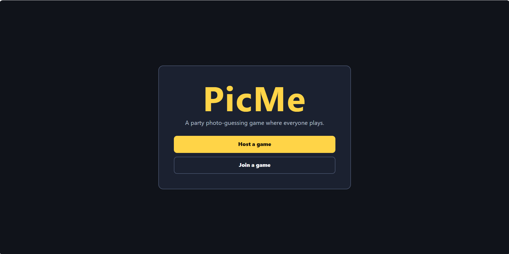
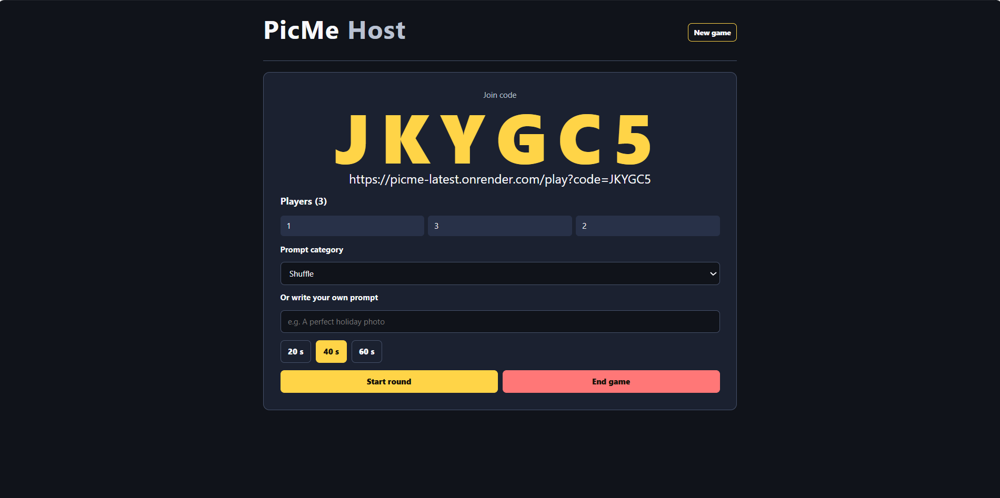
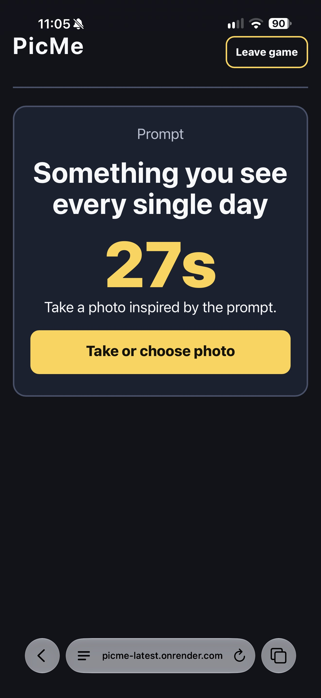
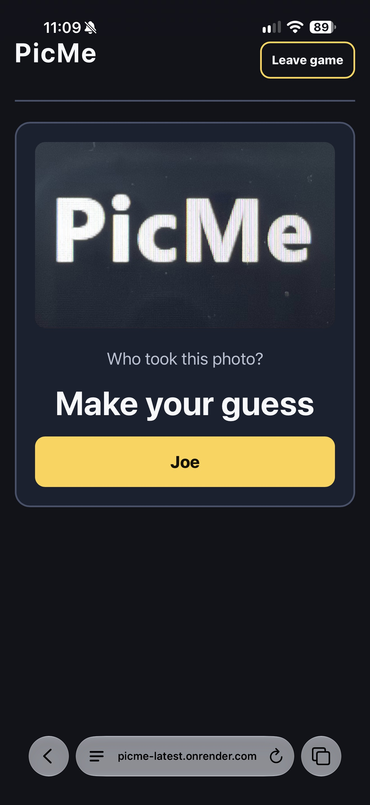
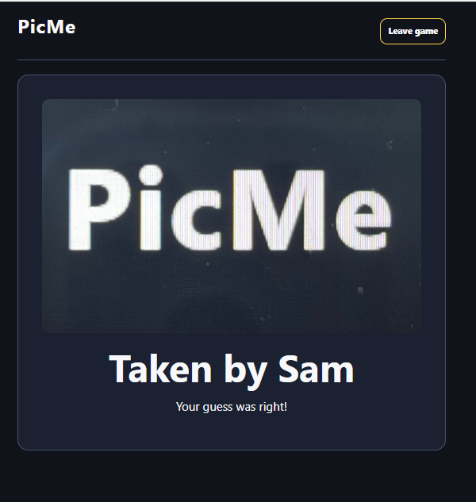
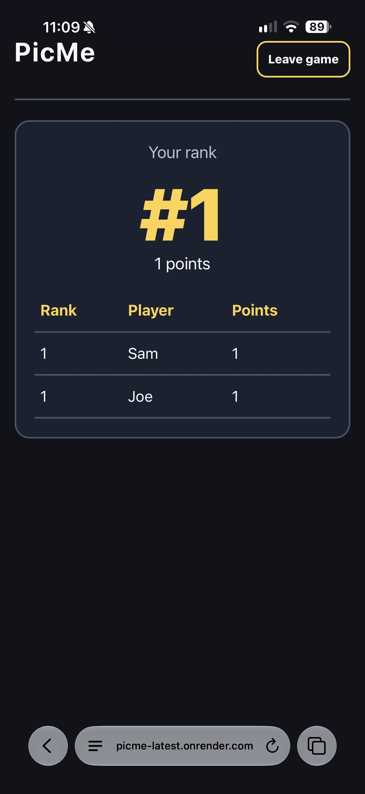
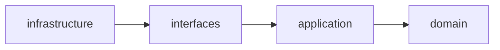

# PicMe

PicMe is a party game. The host shows a prompt on a projector, players upload a
photo from their phones, and everyone guesses who took each photo. Players get
points for correct guesses.

Live: [picme-latest.onrender.com](https://picme-latest.onrender.com)<br>
Host: [/host](https://picme-latest.onrender.com/host)<br>
Players: [/play](https://picme-latest.onrender.com/play)








## How to play

1. The host creates a game and displays the join code.
2. Players join on their phones.
3. The host starts a prompt round; each player sends one photo before the timer ends.
4. Players guess the uploader of each anonymous photo; the host reveals the answer.
5. The host ends the game and players see the ranked scoreboard, or starts another round.

## Use cases

- [UC-001 Create and join a game](docs/specs/UC-001-CREATE-AND-JOIN-GAME.md): create a game, join it with a name, and read its state.
- [UC-002 Play a round and upload](docs/specs/UC-002-PLAY-ROUND-AND-UPLOAD.md): select an unused prompt and upload or replace one JPEG before the deadline.
- [UC-003 Guess who](docs/specs/UC-003-GUESS-WHO.md): submit changeable guesses, close voting, and reveal uploaders.
- [UC-004 Reveal and scoreboard](docs/specs/UC-004-REVEAL-AND-SCOREBOARD.md): score correct guesses, rank players, and play again.

## Architecture

PicMe uses four layers under `src/app/`:



- `domain/` contains entities, value rules, and domain errors.
- `application/` contains use-case services and ports.
- `interfaces/` contains the HTTP API adapters.
- `infrastructure/` contains persistence, photo storage, clock, and web adapters.

Dependencies point inward: `domain <- application <- interfaces <- infrastructure`.
The domain and application layers do not import FastAPI or SQLAlchemy.

The entities are `Game`, `Player`, `Round`, `Photo`, and `Vote`; prompts are
provided by the prompt catalog. The application services are `GameService`,
`RoundService`, `VotingService`, and `ScoreService`. SQLAlchemy 2 is the ORM;
SQLite is used in development and CI, and PostgreSQL on Neon is used in
production.

Architecture decisions: [ADR-001 technology stack](docs/adr/ADR-001-technology-stack.md),
[ADR-002 photo storage](docs/adr/ADR-002-photo-storage.md), and
[ADR-003 polling](docs/adr/ADR-003-live-updates-by-polling.md).

## Getting started

### Local

Python 3.12 is required. From the repository root:

```bash
python -m venv .venv
source .venv/bin/activate
pip install -r requirements.txt
export PYTHONPATH=$PWD/src
python -m uvicorn app.main:app --reload
```

Open `http://127.0.0.1:8000/host` in the host browser and
`http://127.0.0.1:8000/play` on player phones or browser windows.

The application defaults to SQLite. Set `DATABASE_URL` to use another SQLAlchemy
database URL.

### Docker

```bash
docker build -t picme .
docker run --rm -p 8000:8000 picme
```

Open `http://127.0.0.1:8000/host` and `http://127.0.0.1:8000/play`.

## Tests

Unit and integration tests currently pass with **159 tests** combined.

```bash
export PYTHONPATH=$PWD/src
pytest -q tests/unit
pytest -q tests/integration
```

Run E2E tests against a running container:

```bash
docker build -t picme:e2e .
docker run -d --name picme-e2e -p 8001:8000 \
  picme:e2e
BASE_URL=http://127.0.0.1:8001 pytest -q tests/e2e
docker rm -f picme-e2e
```

The architecture check is:

```bash
grep -rnE "fastapi|sqlalchemy" src/app/domain src/app/application
```

CI runs unit, integration, Docker, and E2E checks. The release workflow also
runs E2E tests against the built image.

## Deployment and CI/CD

- **Live:** https://picme-latest.onrender.com (API docs at `/docs`)
- **Hosting:** Render free web service running the Docker image
  `ghcr.io/platonuser/picme`; database on Neon (serverless PostgreSQL, Frankfurt).
- **Pipeline:**
  1. `ci.yml` runs on every pull request and on `main`: structure check, unit and
     integration tests, Docker build plus E2E tests against the container.
  2. `release.yml` runs on a tag `v*`: builds the image, runs the E2E tests against it,
     pushes it to GHCR (`:<tag>` and `:latest`) and creates a GitHub Release.
  3. `cd.yml` runs after a successful Release: triggers the Render deploy hook, waits
     for `/health`, then runs the E2E tests against the live URL. It can also be started
     by hand (Actions → CD → Run workflow).
- **Release:** `git tag vX.Y.Z && git push origin vX.Y.Z`
- **Configuration:** production configuration and deployment credentials are stored
  outside the repository. No credentials are stored in the repository.
- **Limits:** the free Render instance sleeps after 15 minutes without traffic (first
  request then takes about a minute); Neon scales to zero when idle. The health check
  after a deploy can briefly hit the previous version, so CD waits 90 seconds first.

Release history:

- `v0.1.0`: deployment
- `v0.2.0`: UC-003 and UC-004
- `v0.2.1`: foreign-key fix
- `v0.3.0`: UI
- `v1.0.0`: final release

## AI-assisted workflow

The project used OpenCode with GPT-5.6 Luna through the FHNW LiteLLM gateway and
the `baissue` MCP server. `AGENTS.md` routes the AI-SDLC phases, `docs/TASKS.md`
holds the state, `skills/ai-sdlc-0..5` provide phase guidance, and each use case
has a specification. Each use case followed TDD red/green/refactor commits.

Lessons learned:

- Tests written by the agent several times had wrong expected values: scoring
  points were counted for the guessed player instead of the voter, and one
  play-again assertion contradicted the requirement. Counting the outcomes by
  hand caught both errors.
- CD E2E tests against Render found production-only bugs: missing columns because
  `create_all` does not alter existing tables, and a foreign-key violation on
  play again that SQLite did not catch. Both were fixed test-first.
- Manual testing on phones found UI bugs including re-rendering on every poll and
  a redirect loop behind a proxy.
- The requirement that each player sends one photo per round and that the final
  state appears after sending was changed spec-first: specification, tests, then
  code.

## Team and contributions

- **Platon Pashkevych** ([PlatonUser](https://github.com/PlatonUser)): A
- **Snizhana Pashkevych** ([snezhv12](https://github.com/snezhv12)): B

Sprint contributions:

- Sprint 1: both set up the repository, collaboration rules, agent/model choice,
  and BAIssue MCP; A defined the project and UC-001/UC-003 and ADRs; B defined
  UC-002/UC-004 and the walking skeleton and CI.
- Sprint 2: A implemented UC-001, UC-003, and UC-004 and reviewed B's pull
  requests; B implemented UC-002, the release workflow, and the first player UI.
- Sprint 3: A handled Neon, Render, CD, and documentation; B completed host and
  player screens and the full-round E2E test; both rehearsed and tested the live
  game.
- Buffer: fixes from the test round were applied; no UC-005 stretch feature was
  added.

## Known limits

- The Render free tier sleeps after 15 minutes without traffic.
- There are no database migrations: tables are created with `create_all`; model
  changes require a production database reset.
- Clients poll every 1.5 seconds instead of using WebSockets.
- There are no user accounts.
- Photos are stored in the database ([ADR-002](docs/adr/ADR-002-photo-storage.md)).
